# ARCHITECTURE.md — System Design

> Comprehensive architectural documentation for the Job Assigning Timeline Management Platform.
> Every significant design decision is recorded here with rationale.

---

## 1. System Overview

The platform is a decoupled full-stack monorepo:
- **Backend:** NestJS API + Socket.io WebSocket server (port 3001)
- **Frontend:** Next.js App Router SPA (port 3000)
- **Infrastructure:** PostgreSQL + Redis + tooling (all Docker)

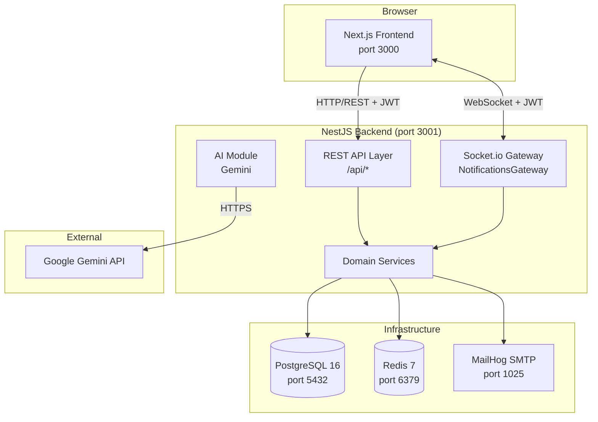

---

## 2. Backend Architecture

### 2.1 Module Dependency Graph

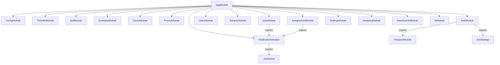

### 2.2 Request Lifecycle

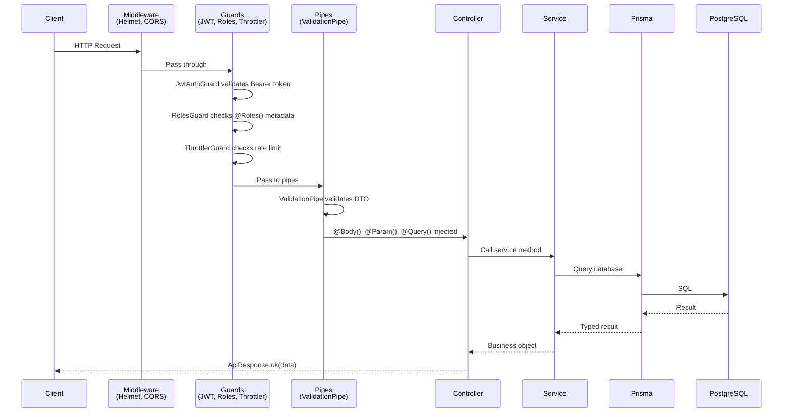

### 2.3 Authentication Flow

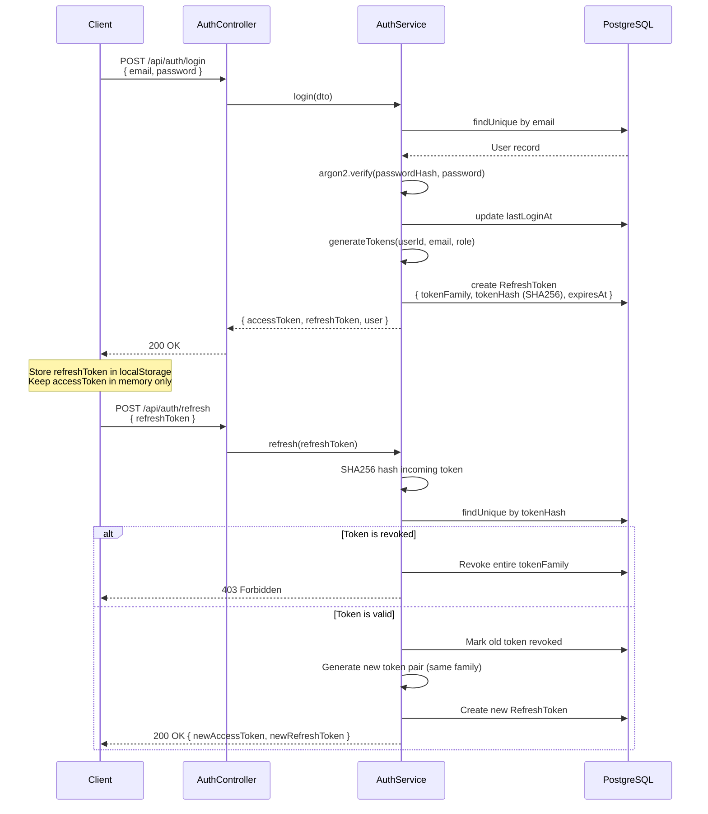

### 2.4 Job Lifecycle State Machine

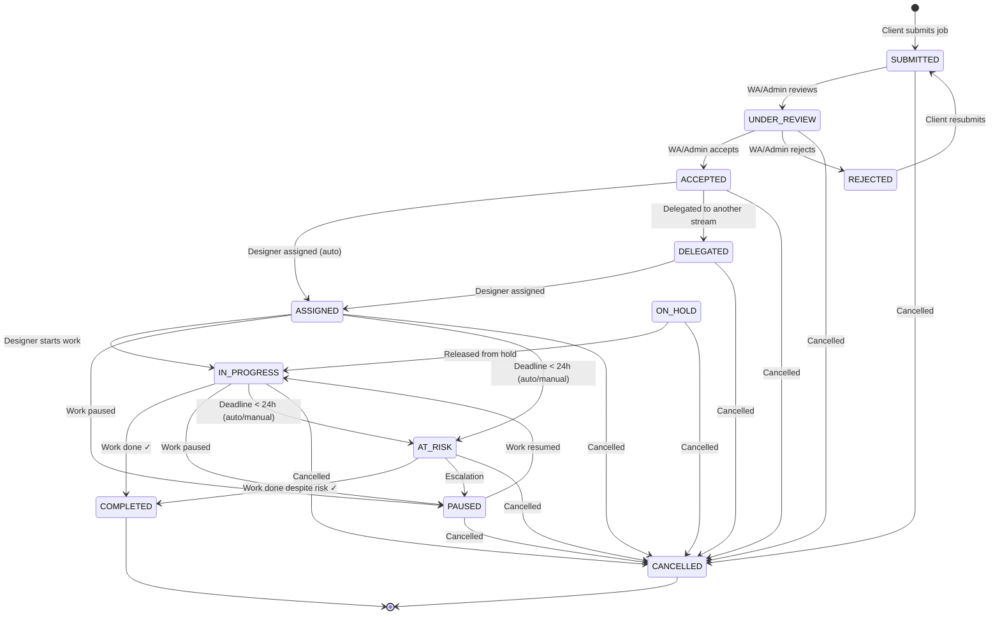

### 2.5 WebSocket Connection Flow

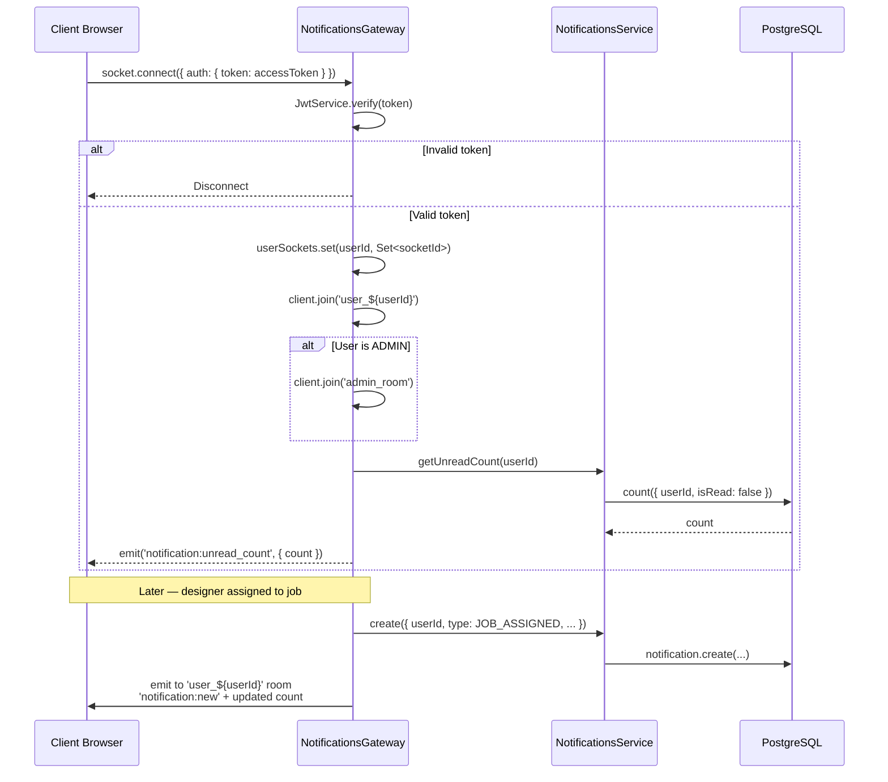

---

## 3. Frontend Architecture

### 3.1 Route Structure

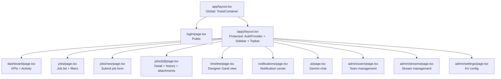

### 3.2 State & Data Flow

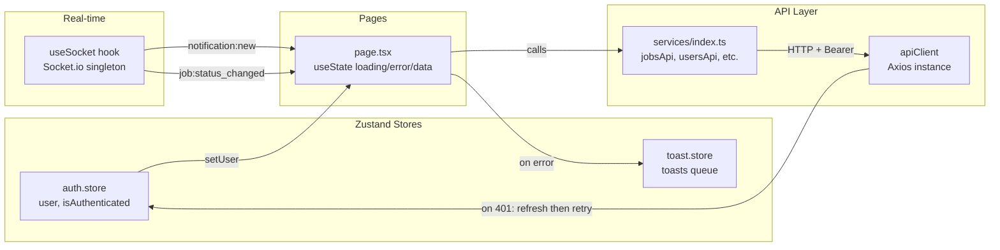

### 3.3 Authentication Bootstrap

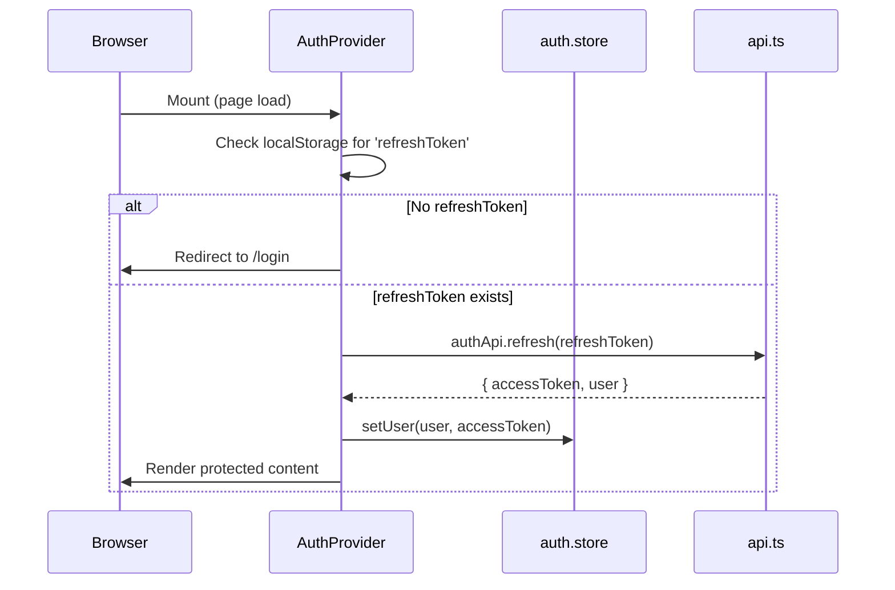

---

## 4. Database Architecture

### 4.1 Entity Relationship Diagram

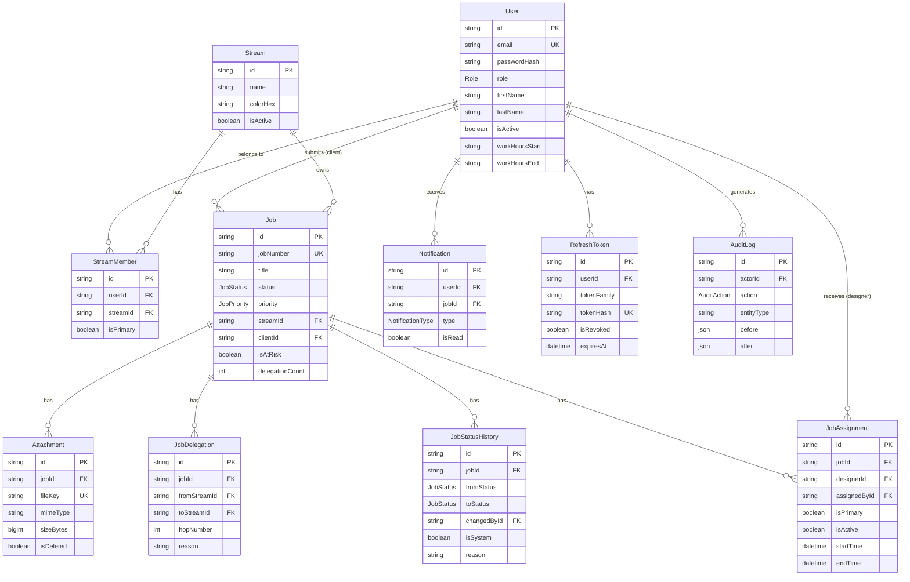

---

## 5. Infrastructure Architecture

### 5.1 Docker Services

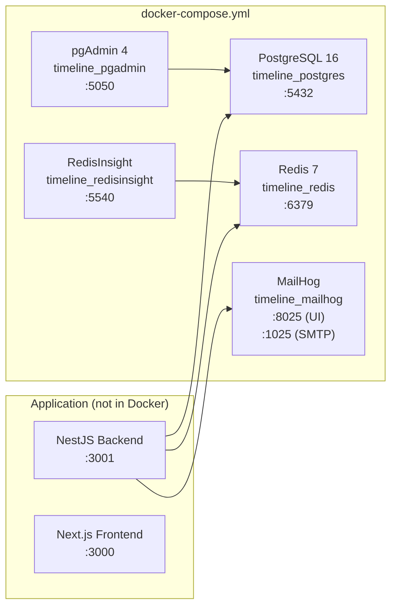

**Why not containerize the app?** Local development with hot-reload works better outside Docker. The infrastructure services (stateful) are containerized; the application (stateless) runs natively for fast iteration.

---

## 6. Security Architecture

### 6.1 Token Security Model

```
┌─────────────────────────────────────────────────────────┐
│  Access Token (JWT)                                      │
│  ├── Lifetime: 15 minutes                               │
│  ├── Signed with: JWT_ACCESS_SECRET                     │
│  ├── Payload: { sub, email, role, iat, exp }            │
│  ├── Storage: Memory only (Zustand store)               │
│  └── Transmission: Authorization: Bearer <token>        │
│                                                          │
│  Refresh Token                                          │
│  ├── Lifetime: 7 days                                   │
│  ├── Format: Random UUID                                │
│  ├── Storage (client): localStorage                     │
│  ├── Storage (server): SHA256 hash in PostgreSQL        │
│  ├── Token Family: UUID grouping for rotation detection │
│  └── Reuse Detection: Revokes entire family on reuse   │
└─────────────────────────────────────────────────────────┘
```

### 6.2 Defense Layers

```
Request
  │
  ▼
[1] Helmet — HTTP security headers (XSS, clickjacking, MIME sniffing)
  │
  ▼
[2] CORS — Origin whitelist (FRONTEND_URL only)
  │
  ▼
[3] ThrottlerGuard — Rate limiting (100/60s general, 10/60s AI)
  │
  ▼
[4] JwtAuthGuard — Bearer token validation + user existence check
  │
  ▼
[5] RolesGuard — Role-based access control
  │
  ▼
[6] ValidationPipe — DTO validation, whitelist, forbid unknown
  │
  ▼
[7] Service logic — Role-scoped DB queries
  │
  ▼
[8] AllExceptionsFilter — Sanitized error responses (no stack traces)
```

---

## 7. Caching Architecture

```
GET /api/jobs (user A)
  │
  ▼
UserCacheInterceptor
  ├── Generates cache key: "userA_id:/api/jobs?status=..."
  ├── Check Redis
  │   ├── HIT → return cached result (max 10s stale)
  │   └── MISS → proceed to service → cache result
  └── TTL: 10 seconds

GET /api/analytics/dashboard (any user)
  │
  ▼
@CacheTTL(30) on controller method
  ├── Cache key: "/api/analytics/dashboard"
  ├── Shared across all users (public KPIs)
  └── TTL: 30 seconds
```

**Cache Invalidation Strategy:** TTL-only. Cache entries expire naturally. There is no explicit invalidation on write. For 10s on jobs and 30s on analytics, this is acceptable for the current load.

---

## 8. AI Architecture

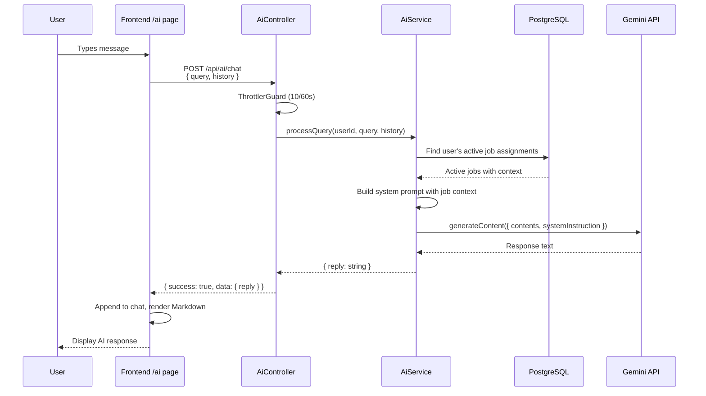

**Current limitation:** AI is read-only. It can discuss jobs but cannot execute actions. Phase 6 will add an `AiActionProposal` flow with human confirmation before execution.

---

## 9. Real-time Architecture

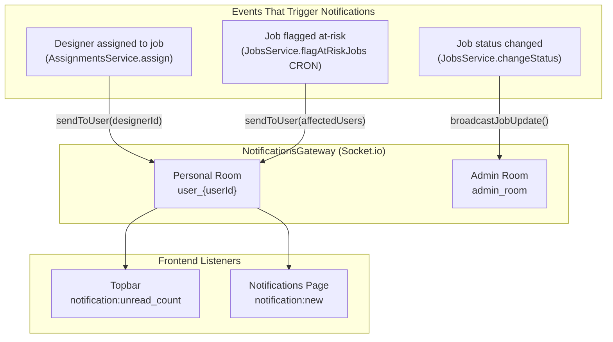

---

## 10. Scalability Considerations

**Current:** Single-node, single-tenant. All state in one PostgreSQL + Redis.

**Phase 5+ path to scale:**

| Concern | Current | Scale Path |
|---------|---------|-----------|
| Database | Single PG instance | Read replicas, connection pooling via PgBouncer |
| Cache | Redis single node | Redis Cluster or Sentinel |
| File storage | Local disk `./uploads` | AWS S3 / GCS (Multer storage adapter swap) |
| Email | MailHog local | SendGrid / AWS SES (SMTP config swap) |
| Background jobs | BullMQ configured, no consumers | Add consumers for email, export, reports |
| Multi-tenancy | Single tenant (`tenantId: "default"`) | Row-level tenancy already designed in schema |
| AI | Single Gemini model | Add model selection, conversation persistence |

---

*Last updated: 2026-06-26*
